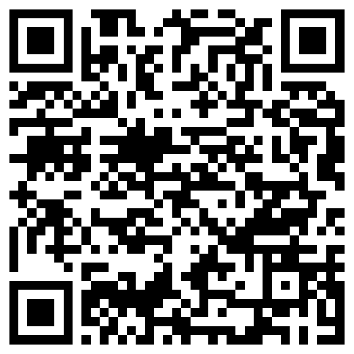

**Español** · [English](README_en.md) · [Polski](README_pl.md) · [Русский](README_ru.md) · [Deutsch](README_de.md)

# Circl3DS 🌸

**Circl3DS** es un juego y motor de ritmo independiente de alto rendimiento para la familia de consolas **Nintendo 3DS, 2DS, New 3DS y New 2DS**, programado desde cero en C++20 con `libctru`, `Citro2D` y `Citro3D`, con compatibilidad total para beatmaps de la comunidad en formato `.osz` y `.osu`.

El juego está ultra-optimizado para funcionar a **60 FPS estables** incluso en la consola original (Old 3DS), aprovechando al máximo la doble pantalla, el stylus táctil y el **efecto 3D estereoscópico real**.

---

### 📲 Instalación rápida (.CIA) — v4.1.0

Escanea el siguiente código QR desde la aplicación **FBI** en tu consola (`Remote Install` ➔ `Scan QR Code`) para descargar e instalar directamente `circl3ds.cia` vía Wi-Fi, o descárgalo desde [Releases v4.1.0](https://github.com/Acira345/Circl3DS/releases/tag/4.1) (`.cia` y `.3dsx`):

<div align="center">
  

  <p><i>Requiere conexión Wi-Fi activa y Custom Firmware (Luma3DS). Incluye actualizador automático integrado en el menú principal.</i></p>
</div>

---

## ✨ Características Principales

### 🎮 Los 4 Modos de Ritmo
1. **Standard (Circles):**
   - **Modo Táctil Directo:** Toca círculos, sliders y spinners con el stylus directamente en la pantalla inferior.
   - **Modo Tablet Virtual:** Juega viendo la pantalla superior mientras usas la pantalla táctil como una tableta gráfica virtual.
   - Sliders curvados Bézier renderizados por hardware GPU, animación fluida (*snake sliders*), approach circles precisos y spinners.
2. **Taiko (Drums):**
   - Carril de notas dinámico con Don (rojo), Katsu (azul), Drumrolls (redobles amarillos) y Denden (spinner gigante).
   - Mascota animada que salta al compás del BPM de la canción.
   - Tambor interactivo táctil de 4 zonas en la pantalla inferior y compatibilidad completa con botones físicos (Cruceta, ABXY, Gatillos L/R).
   - Fondo alternable entre el festival japonés animado o el fondo/video original del beatmap.
3. **Catch (Fruit Catch):**
   - Atrapa frutas, gotas pequeñas (*droplets*) y bananas con el receptor y plato.
   - Efecto visual de **Hyperdash** con destellos y estela roja de aceleración extrema.
   - Control con Circle Pad analógico, Cruceta o botones táctiles.
4. **Mania (Piano/Keys):**
   - Modos 4K y 7K con iluminación de columna y partículas de impacto al pulsar cada nota.
   - Mallas 3D para notas largas (*hold notes*).
   - Ajuste de **Scroll Speed al vuelo** con la cruceta o gatillos.

---

### 👓 Efecto 3D Estereoscópico Real
- Aprovecha el deslizador **3D Slider** de la pantalla superior de la Nintendo 3DS.
- **Profundidad de capas dinámica:** Las notas viajan desde el fondo del túnel 3D hacia el jugador, y los popups de juicio (`300`, `100`, `50`, `Miss`) flotan fuera de la pantalla.

### 🎬 Soporte para Videos de Fondo
- Reproducción fluida de videos musicales adaptados a la 3DS, sincronizados al milisegundo con la pista de audio.
- Incluye el script `convert_videos_3ds.ps1` para optimizar videos.

### ⌨️ Teclado Táctil QWERTY y Filtros en Vivo
- Buscador interactivo en la pantalla inferior que filtra tu biblioteca de canciones **en tiempo real mientras escribes** con el stylus.
- **Chips de filtro rápido:** Filtra instantáneamente por modo (`[STD]`, `[TAIKO]`, `[CATCH]`, `[MANIA]`), dificultades mínimas (`[*4+]`, `[*5+]`) o restablece con `[TODOS]`.

### ⚡ 15 Modificadores de Juego (Mods)
- **Dificultad y Velocidad:** Easy (EZ), NoFail (NF), HalfTime (0.75x HT), HardRock (HR), SuddenDeath (SD), Perfect (PF), DoubleTime (1.5x DT), Nightcore (NC).
- **Visuales y Asistencia:** Hidden (HD), Flashlight (FL), SpunOut (SO), Relax (RX), AutoPilot (AP), Auto y Cinema.

### 📊 Récords Locales y Sistema de Rendimiento (PP)
- Cálculo en tiempo real de puntos de rendimiento (**PP**) según estrellas, precisión y mods.
- Guardado automático de récords locales en la tarjeta SD por canción y modo.
- Pantalla de resultados detallada con desglose de aciertos, combo máximo, gráfica de densidad de esfuerzo (*strain graph*) y grado (SS, S, A, B, C, D, F).

### 📡 Servidor Wi-Fi y Carga Inalámbrica
- Servidor web integrado: transfiere beatmaps `.osz` o carpetas descomprimidas directamente desde el navegador de tu PC o smartphone sin tener que extraer la tarjeta SD.

---

## 📥 Instalación

### Requisitos
- Una consola de la familia Nintendo 3DS / 2DS con Custom Firmware (Luma3DS).
- Tarjeta SD con espacio para canciones.

### Métodos de Instalación:
1. **Formato CIA (Recomendado):**
   - Copia `circl3ds.cia` a tu tarjeta SD e instálalo con **FBI**.
   - Aparecerá directamente en el Menú HOME de tu consola con su icono y banner musical propio.
2. **Formato 3DSX (Homebrew Launcher):**
   - Copia `circl3ds.3dsx` y `circl3ds.smdh` a la carpeta `sdmc:/3ds/circl3ds/`.
   - Ejecútalo desde el **Homebrew Launcher**.

---

## 🎵 Cómo Añadir Canciones (Beatmaps)

Puedes colocar canciones en formato `.osz` o como carpetas descomprimidas en cualquiera de las siguientes rutas de tu tarjeta SD:
- `sdmc:/3ds/circl3ds/songs/`
- `sdmc:/circl3ds/songs/` *(o rutas compatibles anteriores en `sdmc:/3ds/osu-3ds/songs/`)*

> **Nota:** Al abrir el juego, cualquier archivo `.osz` colocado en estas carpetas será extraído y organizado automáticamente. También puedes pulsar **[Y]** en el menú de canciones para activar el servidor Wi-Fi y subirlas desde tu navegador web.

---

## 🕹️ Controles Principales

| Botón | Acción |
| :--- | :--- |
| **Stylus / Táctil** | Tocar círculos/sliders, usar teclado de búsqueda, navegar menús |
| **A / Touch** | Seleccionar canción / Iniciar partida |
| **B** | Volver al menú anterior / Cerrar buscador |
| **Cruceta Arriba / Abajo** | Navegar lista de canciones |
| **Cruceta Izquierda / Derecha** | Cambiar dificultad del mapa |
| **SELECT** | Abrir/Cerrar menú de Mods |
| **START** | Cambiar criterio de ordenación (Título, Artista, Estrellas, PP) |
| **X** | Menú de Ajustes / Calibración de Audio Offset |
| **Y** | Activar servidor de transferencia Wi-Fi |
| **ZL / ZR** | Abrir teclado táctil interactivo de búsqueda |

---

## 🛠️ Compilación desde el Código Fuente

El proyecto utiliza **devkitARM** y **libctru**.

```bash
# Clonar el repositorio
git clone https://github.com/Acira345/Circl3DS.git
cd Circl3DS

# Compilar binarios (.3dsx, .elf, .cia)
make -j4
```

---

## ⚖️ Descargo de Responsabilidad y Créditos
- **Circl3DS** es un proyecto de código abierto independiente para la comunidad homebrew de Nintendo 3DS. No está afiliado, respaldado ni asociado con ppy Pty Ltd ni con Dean Herbert.
- Compatible con formatos de beatmaps abiertos `.osz` / `.osu`.
- Librerías homebrew: *devkitPro*, *libctru*, *Citro2D*, *Citro3D*, *bannertool*, *makerom*.
